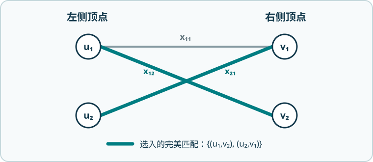
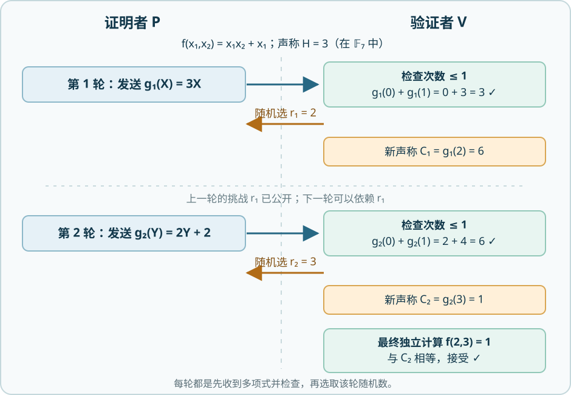
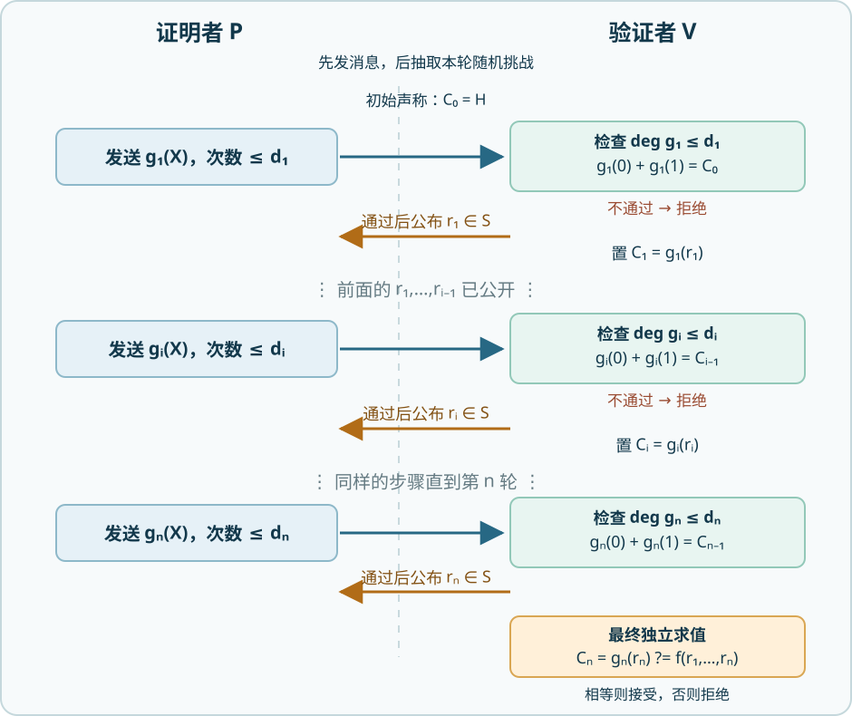

# 第 20 章 Schwartz–Zippel 引理的应用

第 19 章说明：非零多项式在有限网格上不可能有太多零点。本章反过来使用这个结论：把一个错误的声称写成非零多项式，再用随机代入发现它。我们先看可以完整分析的算法，最后走向交互证明与密码学。

```{admonition} 学习目标
:class: tip chapter-goals

- 将恒等式检查转化为非零多项式的零点概率估计。
- 解释矩阵乘法核验和二分图完美匹配中的随机代入。
- 叙述 sum-check 协议并证明其可靠性界。
- 认识密码学证明系统中随机挑战的作用及其额外前提。
```

```{raw} html
<div class="reader-toolbar" role="region" aria-label="逐行阅读控制"><button id="reader-prev">上一段 ↑</button><button id="reader-next">下一段 ↓</button><button id="reader-reset">从头阅读</button><button id="reader-notes" aria-pressed="false">隐藏注释</button><output id="reader-position" aria-live="polite"></output></div>
```

(c20-identity)=
## 问题导入：一次代入能说明什么？

在 $\mathbb F_7$ 中比较 $P(X)=X^2$ 与 $Q(X)=X$。代入 $X=2$，得到 $4\ne2$，立刻确定两者不是同一个多项式。若只代入 $X=0$，两边都为 $0$，却不能据此断言它们相等。接下来三个应用都面对类似的问题：一个随机点上的相等，究竟能提供多强的证据？

(c20-matrix)=
## 应用一：快速核验矩阵乘法

::::{container} statement-box example

:::{container} statement-title
矩阵乘法核验：从一个错误结果出发
:::

在 $\mathbb F_7$ 上，取 $A=I_2$、$B=\begin{pmatrix}1&2\\0&1\end{pmatrix}$，而提交的结果为 $C=\begin{pmatrix}1&2\\1&1\end{pmatrix}$。直接比较可见 $AB\ne C$，错误只在第二行第一列。能否不重新计算整个乘积，也发现这处错误？

试取 $r=(1,3)^T$：$Br=(0,3)^T$，故 $A(Br)=(0,3)^T$，而 $Cr=(0,4)^T$，错误立即暴露。换成 $r=(0,1)^T$，两边却恰好相等。令 $D=AB-C=\begin{pmatrix}0&0\\-1&0\end{pmatrix}$，就看出检查通过当且仅当 $r_1=0$。若在 $\mathbb F_7^2$ 均匀选取，漏检概率恰为 $1/7$。这个例子提示我们：对随机向量检查 $A(Br)=Cr$，可以用较少运算发现错误。

::::

::::{container} statement-box example

:::{container} statement-title
矩阵乘法核验：一般算法
:::

给定 $A,B,C\in\mathbb F^{n\times n}$，假设有人已经算出 $C$，我们希望核验 $AB=C$。若两个矩阵相等，它们作用在每个向量上都相同；若不相等，则可能找到一个使它们作用结果不同的向量。上述例子说明随机选向量的办法。

具体步骤是：先选非空有限集 $S\subseteq\mathbb F$，再独立均匀抽取 $r=(r_1,\ldots,r_n)^T\in S^n$；依次计算 $u=Br$、$v=Au$、$w=Cr$。若 $v\ne w$，拒绝 $C$；否则暂时接受。验证者无需计算或存储 $AB$。若 $AB=C$，每次必然接受。

::::

::::{container} statement-box theorem

:::{container} statement-title
矩阵乘法核验：一般概率界
:::

现在设 $D=AB-C\ne0$。取 $D$ 中一行非零行 $(a_1,\ldots,a_n)$。错误结果通过检查，意味着 $Dr=0$，特别是

$$
a_1r_1+\cdots+a_nr_n=0.
$$

左边是随机坐标的非零一次多项式。由 SZ 引理，等式成立的概率至多 $1/|S|$；要求整个向量 $Dr$ 为零只会使概率更小。因此

$$
\Pr[A(Br)=Cr]\le\frac1{|S|}\qquad(AB\ne C).
$$

这个证明还可不用 SZ 引理直接看出：固定除某个 $a_j\ne0$ 所对应的 $r_j$ 之外的全部坐标，上式至多允许 $r_j$ 的一个取值。这正是一次多项式根数界的最简单情形。

若取 $S=\{0,1\}$，单次漏检概率至多 $1/2$，且这个结论在任意域上成立。重复 $k$ 次并重新独立选向量，全部漏检的概率至多 $2^{-k}$。验证一次需要三次矩阵向量乘法，通常为 $O(n^2)$ 次域运算；直接重新计算矩阵乘积则使用通常的 $O(n^3)$ 算法。随机向量须在给定 $A,B,C$ **之后** 才选出。这就是 Freivalds 算法的基本思想。

```{admonition} 思考
:class: dropdown tip

若 $D$ 只有一个非零元素，且 $S=\{0,1\}$，一次检查漏检的概率是多少？答案是 $1/2$：只有相应坐标取 $0$ 时，$Dr$ 才为零。这说明上述界可以取到。
```

::::

```{admonition} 课外阅读：Freivalds 算法之后
:class: dropdown reading-note chapter-remark

Freivalds 算法用一次随机向量检验 $A(Br)=Cr$，以 $O(n^2)$ 次域运算替代重新计算矩阵乘积；错误结果每轮被漏检的概率至多为 $1/2$。课堂内容已经给出了算法及证明。进一步可读 [Künnemann 的论文](https://drops.dagstuhl.de/entities/document/10.4230/LIPIcs.ESA.2018.56)：它**不是** Freivalds 算法的原始论文，而是从这一算法出发，研究能否用同样快的确定性方法核验矩阵乘积，以及如何纠正少量错误。阅读摘要时可思考：为什么“核验错误结果”和“找出并修正错误”是两个不同任务？
```

(c20-matching)=
## 应用二：用行列式寻找完美匹配

::::{container} statement-box example

:::{container} statement-title
完美匹配：从小图读出行列式
:::

图的左侧为 $u_1,u_2$，右侧为 $v_1,v_2$。它只有三条边：$(u_1,v_1)$、$(u_1,v_2)$ 和 $(u_2,v_1)$。蓝绿色的两条边覆盖全部四个顶点，且互不共用顶点，所以构成一组完美匹配。



现在依图造一个 $2\times2$ 的**符号矩阵**。第 $i$ 行对应 $u_i$，第 $j$ 列对应 $v_j$；若两点之间有边，就在位置 $(i,j)$ 填一个专属于这条边的变量 $x_{ij}$，否则填 $0$。因此

$$
M=\begin{pmatrix}x_{11}&x_{12}\\x_{21}&0\end{pmatrix}.
$$

计算 $2\times2$ 行列式时，必须从每行、每列各取一个位置。只有两种取法：

1. 取主对角线 $(1,1),(2,2)$，对应边 $(u_1,v_1),(u_2,v_2)$。第二条边不存在，故这一项为 $x_{11}\cdot0=0$。
2. 取副对角线 $(1,2),(2,1)$，对应图中的两条蓝绿色边。它们是一组完美匹配，贡献 $-x_{12}x_{21}$；负号来自 $2\times2$ 行列式的公式。

合起来便得到 $\det M=x_{11}\cdot0-x_{12}x_{21}=-x_{12}x_{21}$。因为 $x_{12}$ 和 $x_{21}$ 是独立变量，这一项不会恒为零。灰色边 $x_{11}$ 虽然存在，却找不到与它搭配的 $(u_2,v_2)$，所以没有留下非零的行列式项。若再删去 $(u_2,v_1)$，副对角线项也变成零；此时既无完美匹配，也有 $\det M\equiv0$。

::::

::::{container} statement-box example

:::{container} statement-title
完美匹配：两项与数值抵消
:::

再看完全二分图 $K_{2,2}$，符号矩阵的行列式为 $x_{11}x_{22}-x_{12}x_{21}$。两项分别对应两组完美匹配。四个变量全取 $1$ 时，数值行列式为 $0$；改在 $\mathbb F_7$ 中取 $(x_{11},x_{12},x_{21},x_{22})=(1,1,1,2)$，则行列式为 $1$。所以一次数值结果为零，尚不能断言原来的**形式多项式**恒为零。

::::

::::{container} statement-box example

:::{container} statement-title
完美匹配：符号矩阵的构造
:::

设二分图的左右顶点各为 $n$ 个。构造矩阵 $M=(m_{ij})$：若边 $(i,j)$ 存在，令 $m_{ij}=x_{ij}$，否则令 $m_{ij}=0$，不同边使用不同变量。行列式展开为

$$
\det M=\sum_{\sigma\in\mathfrak S_n}\operatorname{sgn}(\sigma)
\prod_{i=1}^n m_{i,\sigma(i)}.
$$

::::

::::{container} statement-box theorem

:::{container} statement-title
完美匹配：行列式判据
:::

为什么这能判断匹配？排列 $\sigma$ 选出 $n$ 个位置 $(1,\sigma(1)),\ldots,(n,\sigma(n))$，左右顶点都恰好各用一次。乘积 $\prod_i m_{i,\sigma(i)}$ 非零，当且仅当这些位置都有边，也就是一组完美匹配。不同匹配给出不同变量的乘积，因此是不同的单项式，不会在**形式多项式**中相互抵消；在特征 $2$ 中也成立。于是

$$
G\text{ 有完美匹配}\quad\Longleftrightarrow\quad \det M\not\equiv0.
$$

::::

::::{container} statement-box example

:::{container} statement-title
完美匹配：随机赋值与漏检
:::

虽然上述展开有 $n!$ 项，我们不需要将它展开。给各边变量独立地从 $S\subseteq\mathbb F$ 赋值，得到一个数值矩阵，再用通常的消元法计算其行列式即可。若结果非零，图必有完美匹配；若结果为零，则可能根本没有匹配，也可能是随机赋值使非零多项式碰巧取零。由于 $\det M$ 的总次数为 $n$，后一事件的概率至多 $\min\{1,n/|S|\}$。取 $|S|>n$ 才有非平凡的一次成功概率，重复独立赋值可进一步降低漏检概率。这个算法判断的是**是否存在**匹配；数值行列式非零本身尚未列出匹配的边。[延伸阅读](https://introtcs.org/public/lec_16_randomized_alg)

::::

(c20-sumcheck)=
## 应用三：sum-check（求和检验）协议

::::{container} statement-box example

:::{container} statement-title
求和检验：先走一遍两轮对话
:::

在 $\mathbb F_7$ 中取 $f(x_1,x_2)=x_1x_2+x_1$。它在四个布尔点 $(0,0),(0,1),(1,0),(1,1)$ 上依次取 $0,0,1,2$，所以总和为 $H=3$。假设证明者声称这个和等于 $3$，验证者想核验，却不打算亲自逐点求和。

第一轮，证明者把第二个变量的两个布尔值先求和，发送 $g_1(X)=f(X,0)+f(X,1)=3X$。验证者只检查 $g_1(0)+g_1(1)=3$，然后随机选 $r_1=2$。此时原来的四项求和声称缩成 $C_1=g_1(2)=6$。

第二轮，证明者发送 $g_2(Y)=f(2,Y)=2Y+2$。验证者检查 $g_2(0)+g_2(1)=2+4=6$，再随机选 $r_2=3$。最终 $C_2=g_2(3)=1=f(2,3)$（均按模 $7$ 计算）。从四个布尔点之和，逐轮走到了验证者可以亲自计算的一个点值。



图中的 $r_1=2$、$r_2=3$ 是一次可能的随机结果；它们在各轮消息通过检查后才被选出。橙色框记录本轮留下的声称值，供下一轮使用。

若起初的声称改成错误值 $H'=4$，证明者可能试发 $g'_1(X)=4X$：它通过 $g'_1(0)+g'_1(1)=4$，却与真正的 $3X$ 不同。二者只在 $X=0$ 处相等，因此第一轮的错误声称仅在 $r_1=0$ 时碰巧变对；随机从 $\mathbb F_7$ 选挑战，该事件的概率是 $1/7$。这正是后面可靠性分析的雏形。

::::

::::{container} statement-box example

:::{container} statement-title
求和检验：从两轮到一般问题
:::

设 $f\in\mathbb F[x_1,\ldots,x_n]$，每个变量 $x_i$ 的次数至多为 $d_i$。证明者声称

$$
H=\sum_{(b_1,\ldots,b_n)\in\{0,1\}^n}f(b_1,\ldots,b_n).
$$

这里的 $\{0,1\}^n$ 是求和区域，随机挑战则从较大的 $S\subseteq\mathbb F$ 中选取。验证者知道次数界，并且能够在自己选定的点计算 $f$。直接枚举布尔立方体需要 $2^n$ 次求值；协议把这个声称逐轮化为一次点值检查。

刚才两轮中的 $3X$ 与 $2Y+2$，都是“先对尚未固定的变量求和、留下一个变量”的一元多项式。一般协议也依次处理每个变量；关键是验证者每轮只接收一个**低次数一元多项式**，无需自行计算那一轮的庞大求和。

::::

::::{container} statement-box example

:::{container} statement-title
求和检验：一般的第 $i$ 轮
:::

一般地，第 $i$ 轮开始时已有随机点 $r_1,\ldots,r_{i-1}$ 和声称值 $C_{i-1}$，其中 $C_0=H$。证明者发送次数至多为 $d_i$ 的一元多项式 $g_i(X)$，声称它是

$$
T_i(X)=\sum_{(b_{i+1},\ldots,b_n)\in\{0,1\}^{n-i}}
f(r_1,\ldots,r_{i-1},X,b_{i+1},\ldots,b_n).
$$

此处尚未确定的 $n-i$ 个变量仍在布尔立方体上求和，已经确定的坐标则取挑战值 $r_1,\ldots,r_{i-1}$。由于 $f$ 关于 $x_i$ 的次数至多为 $d_i$，真正的 $T_i$ 也满足 $\deg T_i\le d_i$。验证者按以下次序操作：



图中从上到下是时间顺序。蓝色箭头是证明者发送 $g_i$，橙色箭头是验证者在检查通过后才公开 $r_i$；同一轮的 $C_i=g_i(r_i)$ 成为下一轮要检查的声称。

1. 检查消息的次数 $\deg g_i\le d_i$；次数超限就拒绝。
2. 检查 $g_i(0)+g_i(1)=C_{i-1}$；等式不成立就拒绝。
3. 通过后才从非空有限集 $S$ 独立均匀选取 $r_i$，公布它，并令 $C_i=g_i(r_i)$。

经过 $n$ 轮后，验证者亲自计算 $f(r_1,\ldots,r_n)$，检查它是否等于 $C_n$。每轮挑战必须在该轮消息发送后产生；若提前公布 $r_i$，证明者便可能针对这个点专门构造假消息，下面的零点概率界也就不适用了。

::::

::::{container} statement-box theorem

:::{container} statement-title
求和检验：完备性与可靠性
:::

```{admonition} 正确性与可靠性
:class: tip

诚实证明者发送 $g_i=T_i$。把剩余求和按 $b_i=0,1$ 拆开，便得 $T_i(0)+T_i(1)=C_{i-1}$；最后 $T_n(r_n)=f(r_1,\ldots,r_n)$。因此诚实证明者总被接受，称为**完备性**。

若 $H$ 错误，则无论证明者怎样根据已公开的随机数调整下一轮消息，接受概率至多为

$$
\min\left\{1,\frac{d_1+\cdots+d_n}{|S|}\right\}.
$$

这称为**可靠性**。证明时逐轮追踪“当前声称仍然错误”这一状态。只要 $C_{i-1}$ 不等于真正的剩余求和 $T_i(0)+T_i(1)$，通过求和检查的 $g_i$ 就不同于 $T_i$；否则两边在 $0$、$1$ 的和会相等，产生矛盾。此时以前的挑战都已固定，$g_i-T_i$ 是一个**确定的**非零一元多项式，次数至多 $d_i$。在证明者不能预知的新挑战 $r_i$ 处，它等于零的条件概率至多为 $d_i/|S|$。只有发生这件事，错误的声称才可能在进入下一轮时变对。若一直没发生，最终直接求值必使验证者拒绝。对各轮的这种事件取并集界，便得到上述概率。这个论证允许证明者根据旧挑战自适应地选择消息，但要求新挑战独立、均匀且事后公布。
```

::::

::::{container} statement-box example

:::{container} statement-title
求和检验：适用前提
:::

```{admonition} 协议的前提
:class: dropdown reading-note chapter-remark

逐变量次数界用于检查每轮消息，不能只检查求和等式。按系数发送时，通信量为 $\sum_i(d_i+1)$ 个域元素；证明者计算这些求和仍可能很费时。验证者需要能计算最终的 $f(r_1,\ldots,r_n)$，否则必须借助另一个机制证明这个点值。取更大的域可减小错误概率，但所有计算也要能在该域中进行。
```

[Thaler 的教材第 3 章](https://people.cs.georgetown.edu/jthaler/ProofsArgsAndZK.pdf)有协议及可靠性的进一步分析。

::::

(c20-general-principle)=
## 从三个例子归纳：随机恒等检验

上述矩阵核验、匹配检验和求和检验，都把错误声称归结为一个非零多项式在随机点处取零。一般地，设 $P,Q\in\mathbb F[x_1,\ldots,x_m]$，总次数均不超过 $d$。在独立均匀的 $r\in S^m$ 处比较 $P(r)$ 与 $Q(r)$；若 $P\ne Q$，第 19 章的 Schwartz–Zippel 引理给出

$$
\Pr_{r\in S^m}[P(r)=Q(r)]\le\min\{1,d/|S|\}.
$$

重复 $k$ 次且各次独立时，所有检查都碰巧通过的概率至多为 $\min\{1,d/|S|\}^k$。这种检验具有**单侧错误**：真正的恒等式必然通过，错误的恒等式可能漏检。若 $d\ge |S|$，上界可能没有信息；非零形式多项式也可能在整个取样网格上为零，例如 $x^{|S|}-x$ 在 $S=\mathbb F_{|S|}$ 上处处为零。

(c20-crypto)=
## 走向可验证计算与密码学

在 [GKR 协议](https://www.microsoft.com/en-us/research/wp-content/uploads/2016/12/2008-DelegatingComputation.pdf)中，算术电路逐层的计算关系被写成多项式求和，再用 sum-check 将一层的声称归约为随机点处的声称。SZ 引理控制错误的逐轮消息碰巧通过的概率。这是从“检查一个和”走向“检查一项计算”的桥梁。

密码学证明系统还会把大量电路约束编码成多项式关系。例如 [PLONK](https://eprint.iacr.org/2019/953.pdf)使用随机挑战检查编码后的关系；[Spartan](https://iacr.org/archive/crypto2020/12171304/12171304.pdf)使用以 sum-check 为核心的协议。对一条已经确定、次数受限的错误多项式关系，随机点检查的漏检概率由 SZ 引理控制。但完整证明系统的安全性还要处理多项式承诺的绑定性、挑战产生的时序，以及需要时的零知识性质；SZ 引理本身并不保证这些性质。

## 本章自测

```{raw} html
<div class="quiz" data-explain="非零值可以确定行列式多项式不恒为零，因此图有完美匹配。" data-hint="先想行列式展开中的单项式。"><p>二分图的符号矩阵经一次随机赋值后，行列式非零。能否确定图有完美匹配？</p><button data-correct="yes">能</button> <button data-correct="no">不能</button><p class="quiz-feedback" aria-live="polite"></p></div>
```

## 练习与解答

1. 设 $AB\ne C$，在 $\mathbb F_7^n$ 中均匀独立地抽取随机向量核验 $A(Br)=Cr$。连续两次均误判的概率至多是多少？
2. 对只有边 $(1,1),(1,2),(2,2)$ 的二分图，写出符号矩阵及其行列式，并判断是否有完美匹配。
3. 上述 $\mathbb F_7$ 的 sum-check 例子中，若证明者第一轮发送 $g_1(X)=3X+1$ 且仍声称 $H=3$，验证者会在哪一步拒绝？
4. 在 $\mathbb F_7$ 上对 $K_{2,2}$ 的四条边独立均匀赋值。证明数值行列式为零的概率不超过 $2/7$，并解释为什么“四个值全为 $1$”不与此矛盾。
5. 在上述 sum-check 例子中，错误声称为 $H'=4$，第一轮消息为 $g'_1(X)=4X$。验证者选到什么 $r_1$ 时，传给第二轮的声称变为正确？

```{admonition} 参考解答
:class: dropdown tip

1. 单次至多 $1/7$；两次独立，故至多 $1/49$。
2. $M=\begin{pmatrix}x_{11}&x_{12}\\0&x_{22}\end{pmatrix}$，$\det M=x_{11}x_{22}\ne0$，存在完美匹配。
3. 第一轮即拒绝：$g_1(0)+g_1(1)=1+4=5\ne3$（模 $7$）。
4. 符号行列式 $x_{11}x_{22}-x_{12}x_{21}$ 非零，总次数为 $2$；SZ 引理给出至多 $2/7$。全取 $1$ 只是许多赋值中的一个，单个零点并不说明多项式恒为零。
5. 真正的第一轮多项式为 $T_1(X)=3X$。$g'_1(r_1)=T_1(r_1)$ 等价于 $r_1=0$，概率为 $1/7$。
```

## 学习检查

- 对每个应用指出被检验的多项式、次数界和随机取样集合。
- 区分“结果非零即可确定正确”和“结果为零仍可能是漏检”的方向。
- 说明 sum-check 中为什么先发送消息、后公布随机挑战。
- 说明密码学证明系统为什么还需要 SZ 引理之外的机制。

## 学习笔记

记录本章的疑问、证明思路和计算结果。笔记自动保存在当前浏览器，可导出为文本文件。

```{raw} html
<label for="chapter-note-c20">本章笔记</label><textarea id="chapter-note-c20" class="local-note chapter-note" data-page="chapter" placeholder="例如：为矩阵、匹配或求和检验写出错误多项式及概率界。"></textarea>
<button type="button" class="export-notes">导出本章笔记</button>
```
